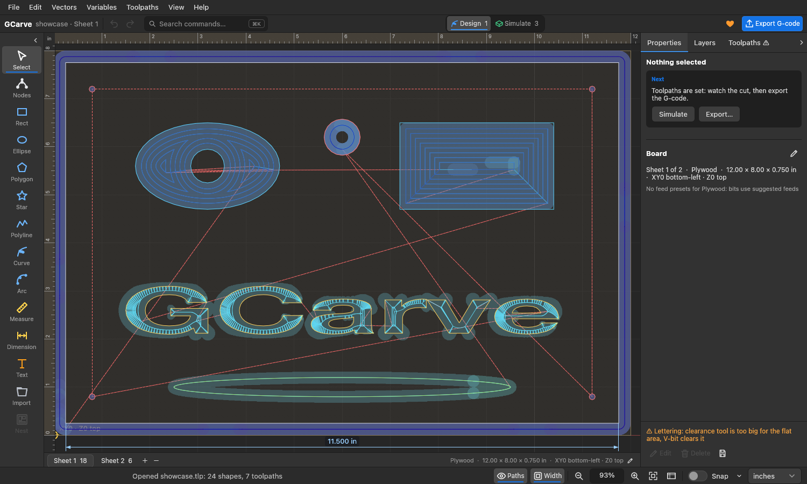

# GCarve

**Free CNC design and toolpath software for Mac, Windows and Linux.** A VCarve alternative: draw or import, make toolpaths, watch the cut in 3D, export safe G-code.

[](https://github.com/fillinthe/gcarve/releases/latest)
[](https://github.com/fillinthe/gcarve/releases)
[](https://gcarve.app/app/)

[**Download**](https://github.com/fillinthe/gcarve/releases/latest) · [Use it online](https://gcarve.app/app/) · [Website](https://gcarve.app) · [Guides](https://gcarve.app/#guides) · [What's new](https://gcarve.app/changelog/) · [Support](https://gcarve.app/support/)



## What it does

- **Toolpaths:** profile (tabs, lead-ins, separate finishing pass), pocket (offset, raster, two-bit), V-carve, inlay, drill, bore and thread milling, chamfer, prism, flute, texture, photo V-carve and 3D relief.
- **Import:** DXF, AutoCAD DWG, SVG, PDF, Illustrator (.ai), STL, pictures to trace, and existing G-code (.tap .nc .gcode .ngc .cnc) from VCarve, Fusion and others: the bit is recognised, the program simulated, checked and re-posted.
- **Check before you cut:** 3D simulation, a safety check on every export (rapids in material, cuts into the spoilboard, spindle off at the end and before every tool change), keep-out areas for clamps, an air-cut test file.
- **Machines and bits:** 66 post-processors (WinCNC, GRBL, Mach3/4, LinuxCNC, ShopBot, Masso, Centroid, UCCNC and more, plus your Vectric .pp files), 29,000+ bits with maker chip loads and 2,100+ machines.
- **Shop extras:** nesting, tiling for boards longer than the table, two-sided jobs, variables and constraints, job time with your machine's acceleration, setup sheets, 3Dconnexion SpaceMouse.

## Download

Get the file for your computer from the [latest release](../../releases/latest). Nothing to install on Windows and Linux: unpack and run.

| Your computer | File |
|---|---|
| macOS (Apple Silicon and Intel) | `GCarve-0.1.7-macOS.dmg` |
| Windows 10 / 11 (64-bit) | `GCarve-0.1.7-Windows-x64.zip` |
| Windows 7 / 8 (64-bit) | `GCarve-0.1.7-Windows-win7-x64.zip` |
| Windows 7 / 8 (32-bit) | `GCarve-0.1.7-Windows-win7-x86.zip` |
| Linux x86_64 | `GCarve-0.1.7-Linux-x86_64.tar.gz` |
| Linux ARM64 (Raspberry Pi 4/5, ARM laptops) | `GCarve-0.1.7-Linux-aarch64.tar.gz` |

`SHA256SUMS.txt` in the release lists a checksum for every file: `shasum -a 256 -c SHA256SUMS.txt`.

### First start

- **macOS:** open the .dmg, drag GCarve to Applications. The app is not notarized by Apple yet, so the first time right-click it and choose **Open**.
- **Windows:** unzip, run `gcarve.exe`. It is not code-signed yet, so SmartScreen may say "unknown publisher": **More info → Run anyway**. Settings live in `%APPDATA%\GCarve`. Needs OpenGL 2.0 (any graphics driver of the last ~15 years). `run-tests.cmd` in the folder is a self-check.
- **Linux:** `tar xzf` the file, then run `./gcarve` (or `./install.sh` to add it to your applications menu). Needs OpenGL 2.0 (Mesa is fine).

Your bit library, machines and settings stay on your computer. Signing in with a free gcarve.app account (optional on the desktop) adds cloud projects and shared libraries.

## System requirements

- **macOS:** Apple silicon or Intel.
- **Windows:** 10 or 11 (64-bit), or 7 / 8 (64-bit and 32-bit builds). No installer, no admin rights.
- **Linux:** x86-64 or ARM64 (Raspberry Pi 4 / 5), glibc 2.31 or newer (Debian 11, Ubuntu 20.04 and later).
- **All:** OpenGL 2.0 graphics (any driver of the last ~15 years; Mesa is fine).

## Not what you need?

The browser version at [gcarve.app/app](https://gcarve.app/app/) is the same program, with nothing to install. It needs a free account (3 cloud projects included; Pro adds 200 projects and team sharing). The desktop apps here are free.

## FAQ

**Is it really free?** Yes, the desktop apps are free, G-code export included. The online version needs a free account (3 cloud projects); Pro ($7/month) adds 200 cloud projects and team sharing.

**Does it work offline?** Yes. Bits, machines and settings stay on your computer.

**Can I open my VCarve files?** Open the .tap / G-code VCarve made, or export your vectors from VCarve as DXF / SVG. `.crv` project files can't be read.

**Can I use my Vectric post-processor?** Yes, load the `.pp` file in the Posts dialog.

## Help and feedback

- Questions, bugs and requests: [gcarve.app/support](https://gcarve.app/support/) or **Help › Request a Change** inside the app.
- Please attach the file that went wrong; the **Export → Setup sheet** and the in-app safety list help us see what happened.

## Safety

GCarve checks every toolpath (rapids in material, cuts below the board, spindle off at the end of every file), but **you are responsible for checking your G-code and your machine before cutting.** Run an air cut first (File › Export Air-Cut Test).

## Licence

GCarve is free to use. The program and its files are © Fill in the Blank, all rights reserved; see the [Terms](https://gcarve.app/terms/) and [Privacy](https://gcarve.app/privacy/) pages. This repository holds the downloads and release notes only; it is not the source code.

## Build from source

The desktop app's source is in `rust/` (engine `gcarve-core`, shared UI `gcarve-ui`, the app `gcarve-app`); the bit and machine database it embeds is in `data/`. You need [Rust](https://rustup.rs) (stable).

```sh
cd rust
cargo run -p gcarve-app --release      # run it
cargo test --workspace                 # tests
```

Packaging scripts for macOS, Windows and Linux are in `rust/packaging/`. The source is published to read and to build for your own use; see [LICENSE.md](LICENSE.md). The website and account server are not part of this repository.
